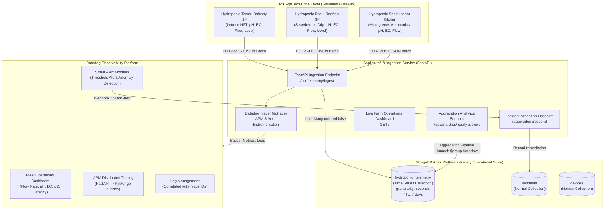

# Solution & System Architecture: Smart Hydroponics Farm

## 1. Tổng quan Kiến trúc Hệ thống

Dự án **Smart Hydroponics Real-time Operations** được xây dựng theo kiến trúc hướng dữ liệu thời gian thực (Real-time AgriTech IoT Telemetry & Observability), tích hợp sâu giữa **MongoDB Time Series Collections** và **Datadog Observability Platform**:

---

## 2. Các tầng trong kiến trúc

### 2.1 Tầng Cảm biến Nông nghiệp (AgriTech Edge)
* Mô phỏng đội giàn thủy canh thông minh gửi gói dữ liệu mỗi 2 giây.
* Cấu trúc 3 phần theo chuẩn MongoDB:
  * `timeField` (`ts`): Kiểu `Date` (ISODate UTC).
  * `metaField` (`sensor`): Nhãn định danh nguồn cảm biến (`id`, `zone`, `crop`, `system_type`).
  * `measurements`: Các chỉ số sinh hóa (`ph`, `ec_ppm`, `water_temp`, `water_level_pct`, `pump_flow_lpm`).

### 2.2 Tầng Ứng dụng & Dịch vụ (FastAPI + ddtrace)
* **Xử lý Batch Ingestion:** Tối ưu hóa ghi dữ liệu với `insert_many(..., ordered=False)`.
* **Tích hợp Datadog APM & Logs:** Tự động tạo spans cho mọi HTTP request, truy vấn database và đính kèm `dd.trace_id` vào log lỗi.
* **Giao diện Web UI:** Phục vụ trực tiếp Dashboard điều hành tại `GET /`.

### 2.3 Tầng Cơ sở dữ liệu (MongoDB Atlas)
* **Time Series Collection (`hydroponic_telemetry`):**
  * Tự động gom dữ liệu vào các bucket tối ưu nén lên đến 1,000 readings hoặc 125 KB/bucket.
  * Tích hợp **TTL Index (`expireAfterSeconds: 604800`)** tự động dọn dẹp các bucket quá 7 ngày tuổi.
* **Collections thường (`devices`, `incidents`):** Lưu trữ metadata giàn thủy canh và nhật ký hành động khắc phục sự cố.

### 2.4 Tầng Quan sát & Vận hành (Datadog Platform)
* **APM & Tracing:** Theo dõi thời gian phản hồi (p95 latency) của endpoint và thời gian ghi vào MongoDB.
* **Logs Correlation:** Khi lưu lượng bơm tụt dốc hoặc pH kiềm hóa, log lỗi được liên kết trực tiếp với trace để truy vết root cause trong vòng 1 cú click.
* **Monitors & Anomaly Detection:** Phát hiện khi lưu lượng bơm $< 1.0\text{ LPM}$ (nghẹt rễ) hoặc $\text{pH} > 7.5$ (khóa dinh dưỡng).
