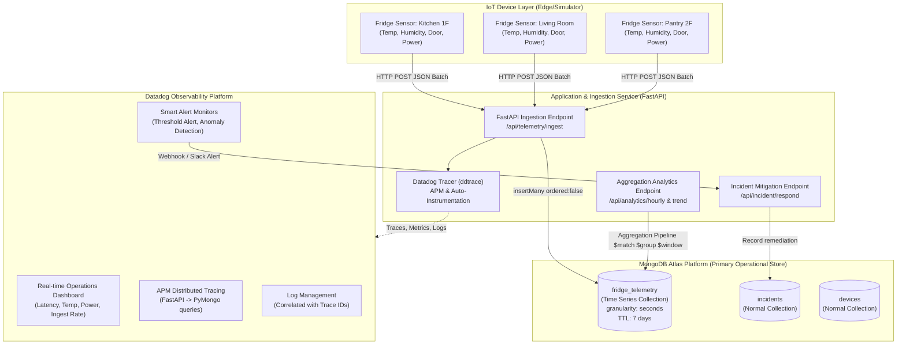

# Solution & System Architecture

## 1. Tổng quan Kiến trúc Hệ thống

Dự án **Smart Fridge Real-time Operations** được xây dựng theo kiến trúc hướng dữ liệu thời gian thực (Real-time IoT Telemetry & Observability), tích hợp sâu giữa **MongoDB Time Series Collections** và **Datadog Observability Platform**:

---

## 2. Các tầng trong kiến trúc

### 2.1 Tầng Cảm biến & Thu thập (IoT Edge Simulation)
* Mô phỏng đội xe/thiết bị tủ lạnh thông minh gửi gói dữ liệu (batch) mỗi 2 giây.
* Payload chứa 3 thành phần theo đúng chuẩn thiết kế của MongoDB:
  * `timeField` (`ts`): Kiểu `Date` (ISODate UTC).
  * `metaField` (`sensor`): Nhãn định danh nguồn cảm biến (`id`, `compartment`, `model`).
  * `measurements`: Các chỉ số đo đạc (`temperature`, `humidity`, `door_open`, `power_watts`).

### 2.2 Tầng Ứng dụng & Dịch vụ (FastAPI + ddtrace)
* **Xử lý bất đồng bộ & Batch Ingestion:** Tối ưu hóa ghi dữ liệu bằng cách sử dụng `insert_many(..., ordered=False)`.
* **Tích hợp Datadog APM:** Tự động tạo spans cho mọi HTTP request, truy vấn database và ghi log có gán kèm `dd.trace_id` và `dd.span_id`.

### 2.3 Tầng Cơ sở dữ liệu (MongoDB Atlas)
* **Time Series Collection (`fridge_telemetry`):**
  * Tự động gom dữ liệu vào các bucket tối ưu nén lên đến 1,000 readings hoặc 125 KB/bucket.
  * Tích hợp **TTL Index (`expireAfterSeconds: 604800`)** tự động dọn dẹp các bucket quá 7 ngày tuổi ngầm dưới nền.
* **Collections nghiệp vụ thường (`devices`, `incidents`):** Lưu trữ metadata thiết bị và nhật ký hành động khắc phục sự cố.

### 2.4 Tầng Quan sát & Vận hành (Datadog Platform)
* **APM & Tracing:** Theo dõi thời gian phản hồi (p95 latency) của endpoint ghi dữ liệu và độ trễ truy vấn PyMongo.
* **Logs Correlation:** Khi có lỗi hoặc cảnh báo vượt ngưỡng, log được liên kết trực tiếp với trace để truy vết root cause trong vòng 1 cú click.
* **Monitors & Anomaly Detection:** Phát hiện khi nhiệt độ vượt ngưỡng an toàn ($>10^\circ\text{C}$ ở ngăn mát) hoặc khi có hiện tượng mở cửa kéo dài.
