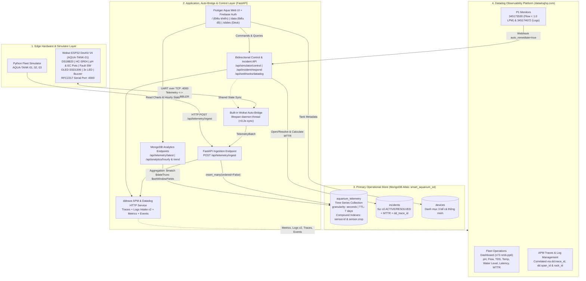

# Kiến trúc Giải pháp & Ứng dụng: Frutiger Aqua Smart Aquarium

## 1. Tổng quan Kiến trúc Hệ thống

Dự án **Frutiger Aqua Smart Aquarium Real-time Operations** được thiết kế theo mô hình **Real-time IoT Telemetry, Bidirectional Hardware Control & Full-stack Observability**, lấy **MongoDB Atlas Time Series** làm kho dữ liệu vận hành trung tâm và **Datadog** làm bộ não giám sát – điều tra – phản ứng sự cố:

---

## 2. Chi tiết 4 tầng trong kiến trúc

### 2.1 Tầng Cảm biến & Phần cứng (`wokwi/` & `simulator/`)
* **Wokwi ESP32 Simulator (`AQUA-TANK-01`):** Mô phỏng vi điều khiển thật chạy firmware Arduino ([wokwi/sketch.ino](file:///f:/Project%20nghịch%20linh%20tinh/mug-hackathon-2026-iot/wokwi/sketch.ino)) với 5 cảm biến và 4 cơ cấu chấp hành trên [wokwi/diagram.json](file:///f:/Project%20nghịch%20linh%20tinh/mug-hackathon-2026-iot/wokwi/diagram.json).
* **Python Fleet Simulator ([simulator/sensor_simulator.py](file:///f:/Project%20nghịch%20linh%20tinh/mug-hackathon-2026-iot/simulator/sensor_simulator.py)) & Web Telemetry Streamer:** Bơm dữ liệu đồng thời cho cả 3 bể (`AQUA-TANK-01` Neon Tetra & Guppy, `AQUA-TANK-02` Clownfish & Coral, `AQUA-TANK-03` Mini Koi & Moss).

### 2.2 Tầng Ứng dụng, Auto-Bridge & Điều khiển (`backend/app/`)
* **Wokwi Auto-Bridge tích hợp sẵn (`_wokwi_auto_bridge_worker`):** Tự động kết nối `127.0.0.1:4000` khi `uvicorn` khởi động; đọc dòng telemetry tiếng Việt từ ESP32 nạp thẳng vào pipeline `ingest_telemetry()` và đẩy lệnh thay đổi từ Web UI xuống ESP32 trong vòng `< 0.2s`.
* **Web UI tách biệt 2 trang + Google Sign-In ([backend/app/static/index.html](file:///f:/Project%20nghịch%20linh%20tinh/mug-hackathon-2026-iot/backend/app/static/index.html), [data.html](file:///f:/Project%20nghịch%20linh%20tinh/mug-hackathon-2026-iot/backend/app/static/data.html)):** Triển khai song song lên **Firebase Hosting** (`https://smart-aquarium-mug-2026.web.app`), hỗ trợ xác thực Google và tự động kết nối API từ xa qua `?api=<url>`.

### 2.3 Tầng Cơ sở Dữ liệu (`MongoDB Atlas — smart_aquarium_iot`)
* Đóng vai trò **Operational Store chính**:
  * Lưu chuỗi thời gian cảm biến trong Time Series Collection `aquarium_telemetry`.
  * Truy vấn tức thời bằng MongoDB Aggregation Pipelines (`$group`, `$dateTrunc`, `$setWindowFields`).
  * Quản lý vòng đời sự cố (`ACTIVE` → `RESOLVED` + tính `mttr_seconds`) trong `incidents`.

### 2.4 Tầng Observability (`Datadog Platform`)
* **Metrics & Ingestion Latency:** Theo dõi 5 chỉ số sinh hóa bể cá (`smartfarm.ph`, `smartfarm.ec_ppm`, `smartfarm.water_temp`, `smartfarm.water_level_pct`, `smartfarm.pump_flow_lpm`), độ trễ ghi MongoDB (`smartfarm.ingest.latency_ms`), số cảnh báo (`smartfarm.alerts.count`) và `smartfarm.incidents.mttr_seconds`.
* **Logs + Traces Correlation:** Mỗi sự cố `[AQUA_ALERT]` hoặc `[INCIDENT_RESOLVED]` gửi lên Datadog Logs Intake v2 kèm `dd.trace_id`, `dd.span_id` và lưu vết vào MongoDB `incidents`.
* **Proactive Alerting & Auto-Remediation:** Monitor P1 phát hiện tắc lọc (`Flow < 1.0 LPM`) có thể bắn Webhook về `/api/webhooks/datadog` để tự động kích hoạt quy trình xả ngược lọc.
